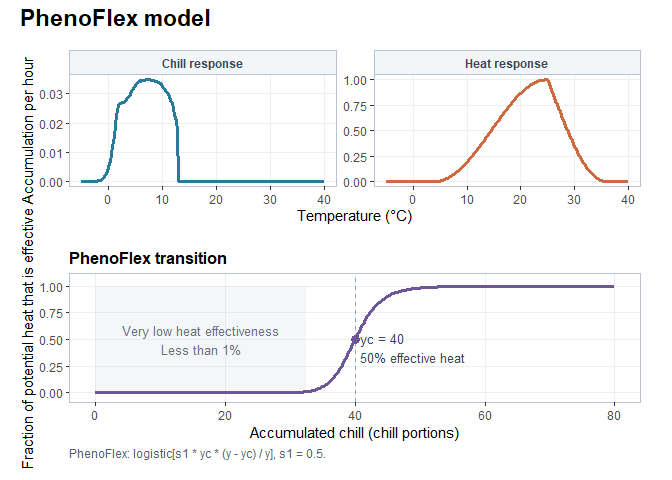

<!-- README.md is generated from README.Rmd. Please edit that file -->

# evalpheno 

<!-- badges: start -->

[](https://lifecycle.r-lib.org/articles/stages.html#experimental)
[](https://doi.org/10.5281/zenodo.15174551)
<!-- badges: end -->

`evalpheno` lets you construct temperature-driven phenology models, set
their parameters, and simulate variation among individual buds. Models
combine chill and heat accumulation with sequential, parallel,
partial-overlap or PhenoFlex structures.

## Installation

Install the development version from GitHub:

``` r
install.packages("remotes")
remotes::install_github("larscaspersen/eval_phenoflex")
```

## Construct a model

Choose a model structure and the chill and heat submodels:

``` r
library(evalpheno)

model <- pheno_model()
```

By default it constructs a PhenoFlex model with Dynamic Model for chill
accumulation and Growing Degree Hour Model for heat accumulation. You
can also choose different model structures by using `"sequential"`,
`"parallel"` or `"partial_overlap"`.

You can visualize the model structure

``` r
plot(model)
```

<!-- -->

Get an overview on the parameters and their meaning with
`parameter_schema()`

``` r
parameter_schema(model)
```

<table>

<thead>

<tr>

<th style="text-align:left;">

name
</th>

<th style="text-align:left;">

component
</th>

<th style="text-align:right;">

default
</th>

<th style="text-align:left;">

description
</th>

<th style="text-align:left;">

unit
</th>

</tr>

</thead>

<tbody>

<tr>

<td style="text-align:left;">

yc
</td>

<td style="text-align:left;">

structure
</td>

<td style="text-align:right;">

4.000000e+01
</td>

<td style="text-align:left;">

Chill requirement
</td>

<td style="text-align:left;">

Chill Portions
</td>

</tr>

<tr>

<td style="text-align:left;">

zc
</td>

<td style="text-align:left;">

structure
</td>

<td style="text-align:right;">

2.857143e+02
</td>

<td style="text-align:left;">

Heat requirement
</td>

<td style="text-align:left;">

h
</td>

</tr>

<tr>

<td style="text-align:left;">

s1
</td>

<td style="text-align:left;">

structure
</td>

<td style="text-align:right;">

5.000000e-01
</td>

<td style="text-align:left;">

Slope parameter for transition from chill accumulation to heat
accumulation
</td>

<td style="text-align:left;">

1 / (Chill Portions)
</td>

</tr>

<tr>

<td style="text-align:left;">

E0
</td>

<td style="text-align:left;">

chill
</td>

<td style="text-align:right;">

4.153500e+03
</td>

<td style="text-align:left;">

time-independent activation energy of forming the precursor to the
dormancy-breaking factor
</td>

<td style="text-align:left;">

dimensionless
</td>

</tr>

<tr>

<td style="text-align:left;">

E1
</td>

<td style="text-align:left;">

chill
</td>

<td style="text-align:right;">

1.288880e+04
</td>

<td style="text-align:left;">

time-independent activation energy of destroying the precursor to the
dormancy-breaking factor
</td>

<td style="text-align:left;">

dimensionless
</td>

</tr>

<tr>

<td style="text-align:left;">

A0
</td>

<td style="text-align:left;">

chill
</td>

<td style="text-align:right;">

1.395000e+05
</td>

<td style="text-align:left;">

amplitude of the (hypothetical) process involved in forming the
precursor to the dormancy-breaking factor
</td>

<td style="text-align:left;">

dimensionless
</td>

</tr>

<tr>

<td style="text-align:left;">

A1
</td>

<td style="text-align:left;">

chill
</td>

<td style="text-align:right;">

2.567000e+18
</td>

<td style="text-align:left;">

amplitude of the (hypothetical) process involved in destroying the
precursor to the dormancy-breaking factor
</td>

<td style="text-align:left;">

dimensionless
</td>

</tr>

<tr>

<td style="text-align:left;">

Tf
</td>

<td style="text-align:left;">

chill
</td>

<td style="text-align:right;">

4.000000e+00
</td>

<td style="text-align:left;">

Transition temperature for irreversible chill conversion
</td>

<td style="text-align:left;">

degree C
</td>

</tr>

<tr>

<td style="text-align:left;">

slope
</td>

<td style="text-align:left;">

chill
</td>

<td style="text-align:right;">

1.600000e+00
</td>

<td style="text-align:left;">

Slope of temperature-dependent chill conversion
</td>

<td style="text-align:left;">

K^-1
</td>

</tr>

<tr>

<td style="text-align:left;">

Tb
</td>

<td style="text-align:left;">

heat
</td>

<td style="text-align:right;">

4.000000e+00
</td>

<td style="text-align:left;">

Base temperature for heat accumulation
</td>

<td style="text-align:left;">

degree C
</td>

</tr>

<tr>

<td style="text-align:left;">

Tu
</td>

<td style="text-align:left;">

heat
</td>

<td style="text-align:right;">

2.500000e+01
</td>

<td style="text-align:left;">

Optimal temperature for heat accumulation
</td>

<td style="text-align:left;">

degree C
</td>

</tr>

<tr>

<td style="text-align:left;">

Tc
</td>

<td style="text-align:left;">

heat
</td>

<td style="text-align:right;">

3.600000e+01
</td>

<td style="text-align:left;">

Upper critical temperature for heat accumulation
</td>

<td style="text-align:left;">

degree C
</td>

</tr>

</tbody>

</table>

Specify model parameters either when constructing the model with the
help of a **named** vector or adjust model parameters later on:

``` r
model$parameters['yc'] <- 80

print(model)
#> Structure:      PhenoFlex
#> Chill submodel: Dynamic Model
#> Heat submodel:  GDH
#> Parameters:
#>           yc           zc           s1           E0           E1           A0 
#> 8.000000e+01 2.857143e+02 5.000000e-01 4.153500e+03 1.288880e+04 1.395000e+05 
#>           A1           Tf        slope           Tb           Tu           Tc 
#> 2.567000e+18 4.000000e+00 1.600000e+00 4.000000e+00 2.500000e+01 3.600000e+01
```

Alternative chill submodels are `chill_hours()`, `chill_utah()` and
`chill_positive_utah()`. `chill_none()` creates a heat-only model,
bypassing chill-dependent coupling. Chill-hours thresholds and Utah zone
weights appear in the parameter schema and can be calibrated.
User-defined chill submodels can be supplied through `chill_custom()`.

## Predict bloom dates

Prepare hourly temperature time series for the model prediction. Use
[chillR
package](https://cran.r-project.org/web/packages/chillR/index.html)
\[@luedelingChillRStatisticalMethods2024\] for data acquisition and
temperature data handling

``` r
data("KA_weather", package = "chillR")
hourly <- chillR::stack_hourly_temps(
  KA_weather, latitude = 50.4)$hourtemps
seasons <- chillR::genSeasonList(hourly, mrange = c(8, 6), years = 1999:2009)
names(seasons) <- as.character(1999:2009)
```

``` r
model <- pheno_model(parameters = c(yc = 40, zc = 250))

predict_phenology(model, seasons)
#>      1999      2000      2001      2002      2003      2004      2005      2006 
#> 111.16667 113.58333 112.91667  92.04167 103.33333 103.04167 102.87500 121.87500 
#>      2007      2008      2009 
#> 102.29167 117.95833 109.08333
```

## Visualize the prcoesses

Plot the chill and heat temperature responses together with their
transition:

``` r
plot_processes(model, seasons, ribbon = TRUE)
```

`plot_processes()` follows chill accumulation, the transition, and
effective heat through time. With a season list, grey curves show
individual seasons and black curves show pointwise medians. A dot marks
the median bloom date, with whiskers spanning the earliest and latest
successful predictions. Set `ribbon = TRUE` to replace the individual
curves with a shaded min-max range. Partial overlap shows its changing
heat requirement in the transition panel; heat-only models show just
heat accumulation.

## Calibrate model parameters

Use the `fit_phenology()` to calibrate the model parameters. Only the
parameters specified in the lower and upper bounds are adjusted. You
need to install the [DEoptim
package](https://cran.r-project.org/web/packages/DEoptim/index.html)
\[@deoptim_package_2011, @ardia_differential_2011\] to run the
calibration, alternatively you can also use the [GenSA
package](https://cran.r-project.org/web/packages/GenSA/index.html)
\[@xiang_generalized_2013\] (which you then need have installed) by
supplying `optimizer = "GenSA"` in the function call.

``` r
require(DEoptim)
#> Loading required package: DEoptim
#> Loading required package: parallel
#> 
#> DEoptim package
#> Differential Evolution algorithm in R
#> Authors: D. Ardia, K. Mullen, B. Peterson and J. Ulrich
model <- pheno_model()
lower <- c(yc = 10)
upper <- c(yc = 80)

#use real observations instead of synthetic ones
observed <- predict_phenology(model, seasons)

#run the optimizer, use more iterations than in this example
fit <- fit_phenology(model, evaluation = phenology_rss, observed = observed,
                     seasons = seasons, lower, upper,seed = 17, max_iterations = 2)
#> Iteration: 1 bestvalit: 2.612847 bestmemit:   38.552002
#> Iteration: 2 bestvalit: 2.612847 bestmemit:   38.552002

print(fit)
#> Calibrated phenology model (DEoptim)
#> Loss: 0 
#> Estimated parameters:
#> yc 
#> 40
```

## Model a bud population

Share chill and potential heat accumulation across buds while allowing
their requirements to vary:

``` r
population <- population_pheno_model(
  structure = "phenoflex", n = 100,
  sd = c(yc = 2, zc = 10), seed = 17
)
means <- model_parameters(population)
means[c("yc", "zc")] <- c(40, 250)

buds <- predict_population_phenology(population, seasons[[1]], parameters = means)
quantile(buds$bloom_jday, c(0.1, 0.5, 0.9), na.rm = TRUE)
#>      10%      50%      90% 
#> 102.2417 111.0417 113.0458
```

Population models also support cutting and constant-temperature forcing
experiments.

For full workflows, see [Getting
started](vignettes/getting-started.Rmd), [Model structures and
submodels](vignettes/model-structures-and-submodels.Rmd), [Model
calibration](vignettes/model-calibration_special-cases.Rmd), and [Bud
populations](vignettes/bud-population.Rmd).
